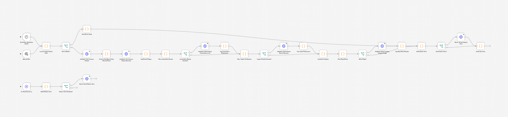

# n8n-hubspot-custom-object-association-integrity-guard

A scheduled n8n workflow that audits HubSpot custom objects (Projects, Shipments, Service Tickets or any other schema) for their mandatory parent associations with Companies and Deals. It flags orphaned and conflicting records in HubSpot and sends RevOps a Slack summary with links to every problem record.

I built it for enterprise portals with multi-object schemas, where a Project without a Company or a Shipment without a Deal quietly breaks rollups, reporting, permissions and downstream automation. Nobody notices until a quarterly report is wrong.

Out of the box it is **mock-driven and read-only**:

- While `HUBSPOT_PRIVATE_APP_TOKEN` is a placeholder, it runs against a bundled demo dataset and makes no HubSpot calls.
- `DRY_RUN=true` and `SANDBOX_MODE=true` stay on unless they are explicitly set to `false`.
- Flag writes need a second opt-in, `FLAG_WRITES_ENABLED=true`.

---

## Contents

1. [What the guard checks](#what-the-guard-checks)
2. [How the workflow runs](#how-the-workflow-runs)
3. [Safety model](#safety-model)
4. [Prerequisites](#prerequisites)
5. [Quick start](#quick-start)
6. [Configuring rules (config.json)](#configuring-rules-configjson)
7. [Environment variables](#environment-variables)
8. [n8n setup, node by node](#n8n-setup-node-by-node)
9. [Scheduling](#scheduling)
10. [Error handling procedures](#error-handling-procedures)
11. [Working with the flags in HubSpot](#working-with-the-flags-in-hubspot)
12. [Local CLI and scripts](#local-cli-and-scripts)
13. [Tests](#tests)
14. [Repository layout](#repository-layout)
15. [Limits and what I could not verify](#limits-and-what-i-could-not-verify)
16. [Disclaimer and license](#️-disclaimer--liability-limitation)

---

## What the guard checks

Each **rule** audits one object type, usually a custom object such as `2-1234567`, although `deals` or `tickets` work too. Each rule lists **requirements**: the parent associations every record must have.

| Requirement option | Meaning |
|---|---|
| `toObjectType` | Parent type: `companies`, `deals`, `contacts`, `tickets` or another custom object ID. |
| `min` / `max` | How many valid associations are required, and how many are allowed. For example, exactly one primary Company is `min: 1, max: 1`. |
| `associationType` or `associationTypeId` + `associationCategory` | Only associations with this label count. Both the typeId and the category must match. |
| `targetWhen` | Conditions on the parent record. For example, the Company must be a customer, or the Deal must not be `closedlost`. |
| `when` | Applies the requirement only to some records. For example, warranty tickets need a warranty Deal. |
| `severity` | `critical` (orphaned or conflict) or `warning` (at risk). |

Rule-level `onlyWhen` and `skipWhen` filters exclude records, for example cancelled projects. A **grace period** (24 hours by default) skips records that were just created, because associations often arrive a few minutes after the record itself.

### Statuses

| Status | When |
|---|---|
| `orphaned` | A critical requirement has fewer valid parents than `min`. |
| `conflict` | A critical requirement has more valid parents than `max`. |
| `at_risk` | Only warning-level requirements are broken. |
| `unverified` | HubSpot returned an error for this record's association read. It is reported but **never flagged**. |
| `healthy` | Every requirement passes. |

### Violation codes

| Code | Example |
|---|---|
| `missing_association` | A Project with no Company at all. |
| `label_mismatch` | A Company is associated, but not with the **Primary Client** label. |
| `dangling_association` | The associated parent no longer exists. |
| `invalid_parent` | A parent exists but fails `targetWhen`, for example the only Deal is closed-lost. |
| `insufficient_associations` | Some valid parents exist, but fewer than `min`. |
| `too_many_associations` | Two primary Companies where `max` is 1. |

---

## How the workflow runs



```
Schedule (Mon–Fri 06:00) ─┐
Manual Run ───────────────┴─▶ Load Config & Safety Gate ─▶ Demo Mode?
                                                             │ yes ─▶ Run Demo Audit ─────────────────────────────┐
                                                             │ no                                                 │
   HubSpot: Get Account Details ◀────────────────────────────┘                                                    │
   ▶ Enforce Sandbox & Plan Record Fetch                                                                          │
   ▶ HubSpot: List Custom Object Records        (GET /crm/v3/objects/{type}, paginated)                          │
   ▶ Tag Record Pages ▶ Plan Association Reads ▶ Association Reads Needed?                                       │
   ▶ HubSpot: Batch Read Associations (v4)       (POST /crm/v4/associations/{from}/{to}/batch/read)              │
   ▶ Tag Association Responses ▶ Plan Target Verification ▶ Target Checks Needed?                                │
   ▶ HubSpot: Batch Read Parent Records          (POST /crm/v3/objects/{parent}/batch/read)                      │
   ▶ Tag Target Responses ▶ Evaluate Integrity ▶ Plan Flag Writes ▶ Write Flags?                                 │
   ▶ HubSpot: Batch Update Integrity Flags       (POST /crm/v3/objects/{type}/batch/update)                      │
   ▶ Tag Flag Write Results ─────────────────────────────────────────────▶ Build Slack Alert ◀──────────────────┘
                                                                          ▶ Send Slack Alert? ▶ Slack: Send Integrity Alert
                                                                          ▶ Audit Summary

On Workflow Error ▶ Build Failure Alert ▶ Failure Alert Enabled? ▶ Slack: Send Failure Alert
```

The Code nodes plan every request and parse every response. The HTTP Request nodes execute them. All logic lives in `src/core/*.js`, and `scripts/build-workflow.js` embeds it into `workflow.json`. Because of that, the Node.js mirror (`src/core/pipeline.js`) and the n8n workflow run identical code. The tests run the generated workflow in a simulator and require the same report the mirror produces.

---

## Safety model

| Layer | Default | Effect |
|---|---|---|
| Demo mode | on while the token is a placeholder | Uses the bundled dataset and the in-memory mock, with no network calls. |
| `DRY_RUN` | `true` | Reads HubSpot and plans flag updates without writing any. Only `false/0/no/off` turns it off. |
| `SANDBOX_MODE` | `true` | Reads `/account-info/v3/details` and stops unless the portal is `SANDBOX` or `DEVELOPER_TEST`, or its ID equals `HUBSPOT_SANDBOX_PORTAL_ID`. Alerts go only to `SLACK_SANDBOX_WEBHOOK_URL`. |
| `FLAG_WRITES_ENABLED` | `false` | A second opt-in for writes. `DRY_RUN=false` alone still writes nothing. |
| Live-mode lock | | When `DRY_RUN=false` and `SANDBOX_MODE=false`, the guard refuses to start with a placeholder token, placeholder object IDs, association label IDs or property names. |
| Fail-closed reads | | Every planned read must be answered. Any failed or missing response stops the run before the write stage. |
| Unverified records | | A per-record HubSpot error never becomes an orphan flag. |
| Circuit breaker | 50% orphan rate, minimum 20 records | An object that looks mostly orphaned usually has a wrong type or label ID, so its flag writes are suppressed and Slack explains why. |
| Write cap | 200 per run | `MAX_FLAG_UPDATES_PER_RUN` caps writes. The most severe findings go first, and the rest wait for the next run. |
| Idempotent writes | | A record whose status and issue text are unchanged is never rewritten. Healthy records that were never flagged are never touched. |
| Secrets out of data | | The token and webhook URLs are read from `$env` inside HTTP Request expressions, so they never appear in item data. Successful executions are not saved (`saveDataSuccessExecution: none`). |
| Slack privacy | | Messages carry record IDs, links and violation text. Record names appear only with `SLACK_INCLUDE_RECORD_NAMES=true`. |

---

## Prerequisites

- **n8n** 1.x with the Code node (v2), HTTP Request node (v4.2), IF node (v2), Schedule Trigger (v1.2) and Error Trigger, self-hosted or with environment-variable access.
- **n8n host settings:**
  - `N8N_BLOCK_ENV_ACCESS_IN_NODE=false`, so Code nodes and expressions can read `$env`.
  - `GENERIC_TIMEZONE` set to the timezone the schedule should follow.
- **A HubSpot private app** (in a sandbox or developer test account first) with these scopes:
  - `crm.schemas.custom.read` for custom object discovery
  - `crm.objects.custom.read`
  - `crm.objects.companies.read` and `crm.objects.deals.read`, plus read scopes for any other parent type you audit
  - `crm.objects.custom.write`, only for flag writes
  - `crm.schemas.custom.write`, only for `npm run properties:create`
  - Scopes for standard objects you audit as rules, such as `crm.objects.deals.write`, if you flag them
- **Slack incoming webhooks:** one for a sandbox or test channel and one for the production RevOps channel.
- **Node.js 20+** for the CLI, the scripts and the tests. There are no npm dependencies.

---

## Quick start

```bash
npm test            # 51 tests, including a full simulated n8n run
npm run demo        # audit the bundled demo portal (no network)
```

The demo portal contains 20 fictional records (Acme Corp, Example Company Inc.) that cover every violation code. The run reports 8 orphaned records, 1 conflict, 1 at risk, 1 unverified, 1 in its grace period, 3 excluded, and 1 previously flagged record that is healthy again.

To try it in n8n:

1. **Import** `workflow.json` (Workflows → Import from File). It imports inactive.
2. **Run it** with **Manual Run**. With placeholder variables, it runs the demo audit and the **Audit Summary** node shows the result. Slack is not called until `SLACK_SANDBOX_WEBHOOK_URL` is set.

---

## Configuring rules (config.json)

1. **Copy the template:** `cp config.example.json config.json`. `config.json` is git-ignored.
2. **Find the object type IDs and association label IDs** against your sandbox:
   ```bash
   export HUBSPOT_PRIVATE_APP_TOKEN=YOUR_HUBSPOT_PRIVATE_APP_TOKEN_HERE   # use your sandbox token
   npm run discover
   ```
   This lists every custom object (`objectTypeId`, name) and, for each object pair in your rules (or every custom object paired with Companies and Deals), the association definitions as `typeId`, `category` and `label`. It is read-only, and `SANDBOX_MODE` applies.
3. **Replace every `YOUR_..._HERE` value**, including the property names used in `displayProperty`, `skipWhen`, `onlyWhen`, `when` and `targetWhen`.
4. **Generate the single-line variable for n8n:**
   ```bash
   npm run config:env
   ```
   Paste the printed `GUARD_CONFIG_JSON=...` line into the n8n environment. The command drops the `environment` block, so secrets never end up inside `GUARD_CONFIG_JSON`, and it warns about any remaining placeholders.

### Rule reference

```jsonc
{
  "key": "projects",                         // unique; used in reports
  "label": "Projects",                       // shown in Slack
  "objectTypeId": "2-1234567",               // custom object ID, or deals/tickets/...
  "enabled": true,
  "displayProperty": "project_name",         // optional; shown in Slack only with SLACK_INCLUDE_RECORD_NAMES=true
  "properties": [],                          // optional extra properties to fetch
  "onlyWhen": [{ "property": "status", "notIn": ["archived"] }],
  "skipWhen": [{ "property": "status", "in": ["cancelled"] }],
  "flag": {                                  // optional; "flag": false disables writes for this rule
    "statusProperty": "association_integrity_status",
    "issuesProperty": "association_integrity_issues",       // null to skip
    "checkedAtProperty": "association_integrity_checked_at" // null to skip
  },
  "requirements": [
    { "key": "primary_company", "label": "Primary client company", "toObjectType": "companies",
      "associationType": "project_to_company_primary", "min": 1, "max": 1, "severity": "critical" },
    { "key": "deal", "label": "Open or won deal", "toObjectType": "deals", "min": 1,
      "targetWhen": [{ "property": "dealstage", "notIn": ["closedlost"] }] }
  ]
}
```

Conditions take exactly one operator: `in`, `notIn` or `isEmpty` (true or false). Values are compared as trimmed strings against HubSpot's internal values, not their display labels.

`associationTypes` is a named catalogue of labels that requirements can reference. Each entry has `fromObjectType`, `toObjectType`, `category`, `typeId` and `label`. When both object IDs are filled in, the guard checks that a referenced label really starts at the object the rule audits.

`settings` holds defaults for the tuning variables below. An environment variable always overrides the matching setting.

---

## Environment variables

| Variable | Default | Purpose |
|---|---|---|
| `HUBSPOT_PRIVATE_APP_TOKEN` | placeholder | Private app token. A placeholder means demo mode. |
| `HUBSPOT_BASE_URL` | `https://api.hubapi.com` | API base URL. |
| `HUBSPOT_SANDBOX_PORTAL_ID` | placeholder | Optional portal ID that `SANDBOX_MODE` also accepts. |
| `GUARD_CONFIG_JSON` | placeholder | Rules, association types and settings on one line (from `npm run config:env`). |
| `DRY_RUN` | `true` | Plan flag writes without writing. |
| `SANDBOX_MODE` | `true` | Sandbox portals and the sandbox Slack webhook only. |
| `FLAG_WRITES_ENABLED` | `false` | Second opt-in for flag writes. |
| `SLACK_WEBHOOK_URL` | placeholder | Production alerts, used only when `DRY_RUN=false` and `SANDBOX_MODE=false`. |
| `SLACK_SANDBOX_WEBHOOK_URL` | placeholder | Alerts in dry-run or sandbox mode. A placeholder means alerts are only logged. |
| `ALERT_ON_CLEAN_RUN` | `false` | Also post when nothing is wrong. |
| `SLACK_INCLUDE_RECORD_NAMES` | `false` | Include `displayProperty` values in Slack. |
| `SLACK_MAX_SAMPLES` | `10` | Findings listed in Slack (0–25). |
| `GRACE_PERIOD_HOURS` | `24` | Skip records younger than this. |
| `MAX_RECORDS_PER_OBJECT` | `10000` | Records audited per object per run. Hitting the limit marks the audit as partial. |
| `HUBSPOT_PAGE_SIZE` | `100` | List page size (1–100). |
| `HUBSPOT_BATCH_SIZE` | `100` | Records per batch read or update (1–100). |
| `MAX_FLAG_UPDATES_PER_RUN` | `200` | Write cap per run. |
| `ORPHAN_RATE_CIRCUIT_BREAKER` | `0.5` | Orphan rate above which an object's writes are suppressed. |
| `CIRCUIT_BREAKER_MIN_SAMPLE` | `20` | Evaluated records needed before the breaker can trip. |
| `VERIFY_TARGETS_EXIST` | `true` | Batch-read parents to catch deleted ones. Parents are always read for `targetWhen`. |
| `FLAG_PROPERTY_GROUP_NAME` | placeholder | Property group for `npm run properties:create`. |
| `AUDIT_NOW` | empty | Testing only: pins the audit clock. |

Every variable is listed in `.env.example`, and `config.example.json` repeats them in its `environment` block for the CLI.

---

## n8n setup, node by node

**1. Host environment.** Set these on the n8n instance, then restart n8n:
- `N8N_BLOCK_ENV_ACCESS_IN_NODE=false`
- `GENERIC_TIMEZONE`
- Every variable from the table above

Code nodes cannot read files, so the rules arrive through `GUARD_CONFIG_JSON`. If you prefer n8n credentials for HubSpot, you can switch the five HubSpot HTTP nodes to a **Header Auth** credential named `Authorization` with the value `Bearer <token>`. Keep `HUBSPOT_PRIVATE_APP_TOKEN` set to any non-placeholder value so demo mode stays off.

**2. Import** `workflow.json`. Every node is pre-configured. What each one does:

| Node | Configuration notes |
|---|---|
| Schedule: Weekdays 06:00 | Cron `0 6 * * 1-5`. See [Scheduling](#scheduling). |
| Manual Run | For tests and re-runs. |
| Load Config & Safety Gate | Validates everything and throws on any error, before any HubSpot call. |
| Demo Mode? | Routes to the bundled demo while the token is a placeholder. |
| HubSpot: Get Account Details | `GET /account-info/v3/details`. The `Authorization` header is `Bearer {{ $env.HUBSPOT_PRIVATE_APP_TOKEN }}`. |
| Enforce Sandbox & Plan Record Fetch | Stops on a non-sandbox portal while `SANDBOX_MODE=true`. Emits one list request per rule. |
| HubSpot: List Custom Object Records | Pagination: **Update a Parameter in Each Request**, query `after` = `paging.next.after`, complete when there is no next page. **Max pages 100** (100 × 100 = 10,000 records per object), 150 ms between pages. Raise *Max Pages* if you raise `MAX_RECORDS_PER_OBJECT`. |
| Tag Record Pages | Pairs each page with its rule (`itemMatching`). |
| Plan Association Reads | One v4 batch read per 100 evaluable records per parent type. |
| HubSpot: Batch Read Associations (v4) | Batching: 5 requests per 1.1 s. A **207** response is normal, because records without associations come back as errors. |
| Plan Target Verification | Checks that every association read was answered, then plans parent reads. |
| HubSpot: Batch Read Parent Records | `POST /crm/v3/objects/{parent}/batch/read` with the `targetWhen` properties. |
| Evaluate Integrity | Pure evaluation. Outputs the report and flag plan. |
| Plan Flag Writes / Write Flags? | Emits batch updates only when `DRY_RUN=false` and `FLAG_WRITES_ENABLED=true`. |
| HubSpot: Batch Update Integrity Flags | `POST /crm/v3/objects/{type}/batch/update`. Retries are safe because writes are idempotent. |
| Build Slack Alert / Send Slack Alert? | Decides the target. The URL expression reads `$env` at request time. |
| Slack: Send Integrity Alert | Posts the Block Kit payload. |
| Audit Summary | A compact JSON result of the run, also visible for manual runs. |
| On Workflow Error → Slack: Send Failure Alert | Failure alert with secrets redacted. See below. |

All HubSpot nodes retry 3 times, 3 seconds apart. They deliberately do **not** use "continue on error": a failed read must stop the run instead of producing orphan flags from partial data.

**3. Error workflow.** Open *Workflow Settings → Error Workflow* and select this same workflow, so its **On Workflow Error** branch runs on failures. If your n8n version does not let a workflow be its own error workflow, copy the four failure nodes into a separate workflow and select that one.

**4. Create the flag properties** in your sandbox. Set `DRY_RUN=false` for this one command only:
```bash
DRY_RUN=false npm run properties:create
```
This creates `association_integrity_status` (a select with healthy, at_risk, conflict and orphaned), `association_integrity_issues` (multi-line text) and `association_integrity_checked_at` (date-time) on each flagged object. Properties that already exist are left alone. Run it without `DRY_RUN=false` first to see the payloads.

**5. Roll out in stages.** Change one variable at a time:

| Stage | Settings | What to check |
|---|---|---|
| 1. Demo | token placeholder | The Audit Summary looks right. |
| 2. Sandbox read-only | sandbox token, `GUARD_CONFIG_JSON`, `SLACK_SANDBOX_WEBHOOK_URL` | The findings match what you see in the sandbox UI. |
| 3. Sandbox writes | `DRY_RUN=false`, `FLAG_WRITES_ENABLED=true` | Flags appear. A second run plans 0 changes. |
| 4. Production read-only | production token, `SANDBOX_MODE=false`, `DRY_RUN=true` | Alerts still go to the sandbox webhook. Review the orphan rates. |
| 5. Production | `DRY_RUN=false`, `FLAG_WRITES_ENABLED=true`, `SLACK_WEBHOOK_URL` | Activate the workflow. |

---

## Scheduling

The Schedule Trigger uses the cron expression `0 6 * * 1-5` (06:00 Monday to Friday, in `GENERIC_TIMEZONE` or the workflow's own timezone setting). To change it, open the node and edit the expression:

| Cadence | Cron |
|---|---|
| Every weekday at 06:00 | `0 6 * * 1-5` |
| Daily at 02:30 | `30 2 * * *` |
| Every 6 hours | `0 */6 * * *` |
| Mondays at 07:00 | `0 7 * * 1` |

How to choose a cadence:

- **API budget.** A run costs about 1 + ⌈records / 100⌉ list calls, plus ⌈evaluable records / 100⌉ × parent types association calls, plus ⌈distinct parents / 100⌉ parent reads, plus ⌈updates / 100⌉ writes. For 10,000 Projects with two parent types, that is roughly 300 to 500 calls per run, paced at 5 per 1.1 seconds. Check your HubSpot tier's burst and daily limits if you run hourly across many objects.
- **Grace period.** Keep `GRACE_PERIOD_HOURS` longer than the time your integrations need to create associations after a record is created.
- **Quiet hours.** Schedule outside busy import windows. Records that are mid-import can look orphaned, although the grace period absorbs most of this.
- **Overlap.** Do not let runs overlap. A daily or weekday cadence is plenty for most portals.

---

## Error handling procedures

| Symptom | Cause | What to do |
|---|---|---|
| Run stops in **Load Config & Safety Gate** with "Configuration invalid" | A placeholder or malformed value | Read the bullet list in the error, fix the variable, re-run manually. |
| "SANDBOX_MODE=true, but the connected portal ... I refuse to continue." | Production token while sandbox mode is on | Use a sandbox token, set `HUBSPOT_SANDBOX_PORTAL_ID`, or set `SANDBOX_MODE=false` on purpose. |
| HubSpot node fails with 401 or 403 | Expired token or missing scope | Rotate the token or add the scope (see [Prerequisites](#prerequisites)). |
| HubSpot node fails with 429 after retries | Rate limit | Schedule outside other heavy integrations, lower the cadence or lower `HUBSPOT_BATCH_SIZE`. |
| HubSpot node fails with 400 "Unable to infer object type" | Wrong `objectTypeId` or `toObjectType` | Run `npm run discover`. |
| "the association read stage planned N request(s) but received M" | A read was lost | The run stopped before writing anything. Re-run manually. If it repeats, check the n8n logs for the HTTP node. |
| Slack shows a :rotating_light: circuit breaker line | Implausible orphan rate | Usually a wrong label `typeId` or `category`, or a wrong object ID. Verify with `npm run discover`. Writes stay suppressed until the rate drops below the threshold. |
| Records listed as **unverified** | Per-record errors from HubSpot | They are not flagged. They are retried on the next run. |
| ":warning: Record limit reached" | More records than `MAX_RECORDS_PER_OBJECT` or the node's Max Pages | Raise both together. Records beyond the limit are not audited in that run. |
| "flag write stage planned N ... received M" | A batch update was lost | Flags written so far are correct. Re-run, because writes are idempotent. |
| Slack failure alert received | Any node failed | Open the execution (failed executions are saved), fix the cause, re-run manually. |

**Recovering a bad flag write.** Flags never change associations, only the three flag properties. To undo flags for a rule:
1. Set `"flag": false` on that rule, or set `DRY_RUN=true`.
2. Clear the properties in a HubSpot list view, or with a HubSpot workflow.
3. Fix the rule, then re-enable it.

---

## Working with the flags in HubSpot

- **Views.** Create a saved view per object where *Association Integrity Status* is any of orphaned or conflict. That gives the RevOps queue.
- **Workflows.** Trigger a HubSpot workflow when the status becomes `orphaned`, for example to create a task for the record owner. Exclude the status from any workflow that changes associations automatically unless a human reviews it first.
- **Reports.** Track orphan counts per object over time to show data-quality trend lines.
- **Clearing.** When a record is fixed, the next run sets it back to `healthy` and blanks the issue text. Healthy records that were never flagged are never touched, so the first production run only writes to problem records.

---

## Local CLI and scripts

| Command | Purpose |
|---|---|
| `npm run demo` | Audit the bundled demo portal. |
| `npm run audit` / `npm start` | Audit using `.env` and `config.json` (or `GUARD_CONFIG_JSON`). Demo mode applies while the token is a placeholder. |
| `node src/index.js --json` | Full report, flag plan and Slack payload as JSON. |
| `node src/index.js --fail-on-findings` | Exit code 3 when orphaned or conflicting records exist (useful in CI). |
| `node src/index.js --config other.json` | Read rules from another file. |
| `npm run discover` | List custom object IDs and association labels (read-only). |
| `npm run properties:create` | Create the flag properties. Dry run by default. |
| `npm run config:env` | Print the `GUARD_CONFIG_JSON` line for n8n. |
| `npm run build:workflow` | Regenerate `workflow.json` after editing `src/core`. |
| `npm run check:workflow` | Fail if `workflow.json` is out of date. |

The CLI applies variables in this order: the shell, then `.env`, then the `environment` block in `config.json`.

---

## Tests

```bash
npm test
```

There are 51 tests across two files:

- `tests/integrity.test.js` covers:
  - configuration parsing and every safety switch
  - each violation code
  - HubSpot response parsing, including 207 multi-status errors
  - sandbox enforcement
  - the demo classification
  - dry run vs. write behaviour, idempotency, the write cap and the circuit breaker
  - pagination limits, Slack privacy, secret redaction and HTTP retries
- `tests/workflow.test.js` checks that `workflow.json` matches the build script, that no credentials are embedded and that every node is reachable. It also runs the workflow in `tests/n8n-simulator.js`, which executes the real Code node source, IF and HTTP expressions, pagination and paired items. In demo mode, paginated dry-run mode and write mode, the result must exactly match the Node.js mirror, including the final HubSpot state. It also covers the sandbox refusal, invalid configuration, a failed association read (no writes), empty objects and the failure branch.

---

## Repository layout

```
├── workflow.json                 n8n export (generated; 31 nodes)
├── config.example.json           rules, association types, settings and environment template
├── .env.example                  every environment variable with safe defaults
├── src/
│   ├── core/
│   │   ├── config.js             loading, validation, safety switches, Slack target
│   │   ├── integrity.js          evaluation engine, report, flag plan, circuit breaker
│   │   ├── hubspot.js            request builders and response parsers (no network)
│   │   ├── slack.js              Block Kit alerts, failure alerts, redaction
│   │   ├── pipeline.js           Node.js mirror of the workflow, HTTP client with retries
│   │   ├── demoData.js           bundled demo schema and records
│   │   └── mockHubSpot.js        in-memory HubSpot used by demo mode and tests
│   ├── cliSupport.js             .env and config.json loading for the CLI
│   └── index.js                  CLI entry point
├── scripts/
│   ├── build-workflow.js         embeds src/core into workflow.json
│   ├── discover-schema.js        read-only object and label discovery
│   ├── create-flag-properties.js one-time property setup
│   └── config-to-env.js          config.json → GUARD_CONFIG_JSON
├── tests/                        node:test suites and the n8n simulator
├── DISCLAIMER.md
└── LICENSE
```

---

## Limits and what I could not verify

I tested everything against the in-memory HubSpot mock and the workflow simulator, not against a live n8n instance or a live HubSpot portal. Before relying on it, please confirm the following in your own environment:

- **n8n parameter names.** The HTTP Request node's pagination block (`updateAParameterInEachRequest`, `completeExpression`, `maxRequests`) and batching block match the v4.2 format as I understand it. After importing, open the list node and check that pagination shows as configured.
- **Paired items.** The tag nodes use `$('Node').itemMatching(index)` to pair each response with its request, including the pages of a paginated request. This is the documented n8n pattern, but I have not run it on a live instance.
- **Unexecuted-node references.** References to nodes on skipped branches are wrapped in `try/catch` and backed by the completeness checks, so a mismatch stops the run instead of producing false orphans.
- **HubSpot response shapes.** These come from HubSpot's documented formats, but I could not confirm them live:
  - v4 batch association reads report records with no associations as per-record errors, and the guard treats that as zero associations.
  - Batch reads may answer 404 instead of 207 when *every* requested parent is missing. In that case the run stops and the failure alert explains it.
- **Truncated association lists.** A v4 response returns a limited number of associations per record. When HubSpot signals more, the count is treated as a lower bound, which only matters for `max` checks above that size.
- **Error workflow pointing to itself.** Some n8n versions may not allow it. The fallback is a separate error workflow, as described in step 3 above.
- **Sandbox detection** relies on `accountType` from `/account-info/v3/details`. HubSpot documents the values `STANDARD`, `SANDBOX`, `DEVELOPER_TEST` and `APP_DEVELOPER`.
- **What it does not do.** It audits associations; it never creates or removes them. Fixing an orphan is a human decision.

---

## Author

**DH Robin | dhRobin Systems**: [https://dhrobinsystems.com](https://dhrobinsystems.com)

I design revenue infrastructure: CRM architecture, data integrity and automation for complex HubSpot portals. Issues and pull requests are welcome.

---

## ⚠️ Disclaimer & Liability Limitation

Use at your own risk. The code, workflows, and scripts provided in this repository (`n8n-hubspot-custom-object-association-integrity-guard`) are for educational and architectural demonstration purposes.

* **No Liability:** The author and dhRobin Systems assume no responsibility or liability for any direct, indirect, incidental, or consequential damages resulting from the use, misuse, or deployment of these scripts.
* **No Warranty:** All software, n8n JSON blueprints, and JavaScript modules are provided "AS IS" without warranty of any kind, express or implied, including but not limited to merchantability, fitness for a particular purpose, or non-infringement.
* **Production Testing Required:** Always test thoroughly in an isolated staging environment (for example a HubSpot developer test account or sandbox) with `SANDBOX_MODE=true` and `DRY_RUN=true` enabled before connecting live HubSpot credentials. Treat every flag write as a change to live CRM records that reports, views and other workflows may react to.
* **Third-Party APIs & Compliance:** Users are solely responsible for complying with the terms of service, rate limits, data privacy regulations (GDPR/CCPA), and security policies of HubSpot, Slack and any connected services. That includes confirming that everyone in the receiving Slack channel may see the record IDs and links the guard posts, keeping record names out of Slack unless that is permitted, and reviewing every flagged record before its associations are changed.

The full disclaimer is also available in [DISCLAIMER.md](https://github.com/dhrobinsystems/n8n-hubspot-custom-object-association-integrity-guard/blob/main/DISCLAIMER.md).

## License

Released under the MIT License. Copyright (c) 2026 DH Robin (dhRobin Systems). See [LICENSE](https://github.com/dhrobinsystems/n8n-hubspot-custom-object-association-integrity-guard/blob/main/LICENSE).

Full text: DISCLAIMER.md · Licensed under the MIT License. License: MIT © 2026 dhRobin Systems · Provided as-is, see the disclaimer.
